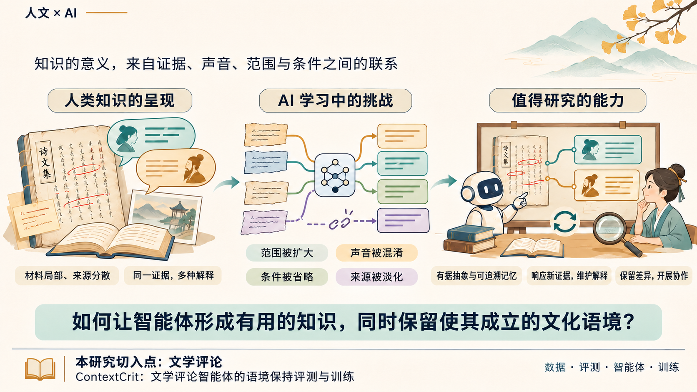

# ContextCrit 研究背景配图与讲稿

PNG 顶部主标题已移除并留白，可在 PowerPoint 中自行添加文本框；其余三栏图示、问题与页脚保留。

## 精简讲稿（约 1 分钟）

这项研究关注一个问题：AI 从文化材料中学习时，如何保留使知识有意义的语境？人类知识往往来源分散，同一证据也可能有不同解释。模型在抽象和记忆时，容易扩大范围、混淆声音、遗漏条件或淡化来源。因此，我们希望智能体能够形成有依据、可追溯的知识，响应新证据，并在保留不同观点的基础上开展协作。我的研究以文学评论为切入点，通过数据、评测、智能体和训练四个环节探索这一问题。
