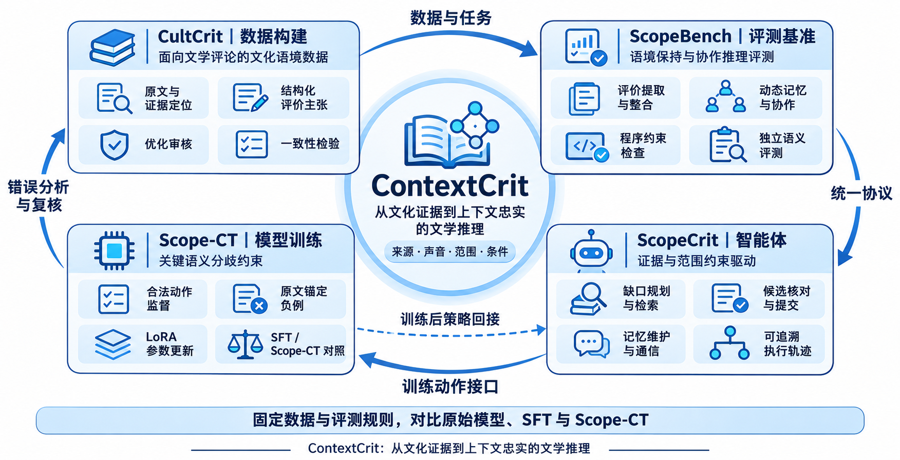

# ContextCrit 研究思路

## 精简讲稿

我的研究思路是围绕文学评论，建立“数据—评测—智能体—训练”的研究闭环。首先，CultCrit 将原文组织为保留来源和语境边界的结构化任务，并进行审核与一致性检验。ScopeBench 提供统一的任务协议和评价标准，ScopeCrit 通过证据检索、主张核对、记忆维护与通信完成推理。在此基础上，Scope-CT 利用合法动作监督和关键语义分歧约束训练模型。最后，将训练后的策略接回同一智能体，在固定数据和评测规则下与原始模型、普通 SFT 对照，并用错误分析指导后续复核。

## 图示说明

闭环表示模块之间的研究衔接和反馈，不代表实验效果已经得到证明。教师动作来自训练标签并经执行器校验；训练后的模型策略重新接入智能体。错误分析用于后续复核，对照实验中的测试集及评价规则保持固定。
